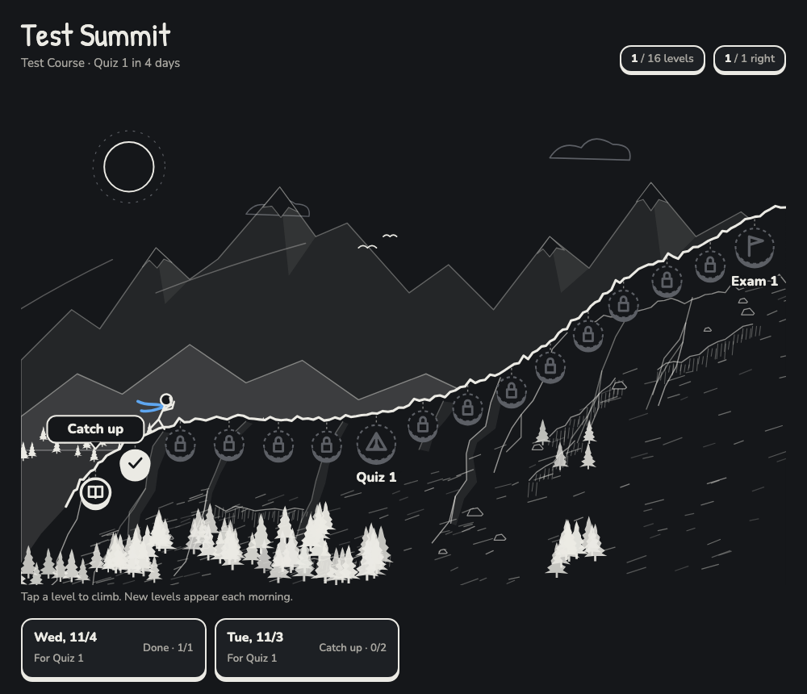

# Summit

A daily study quiz that feels like a climb. Summit turns your course schedule into a
mountain: every day a new quiz level appears on the trail, quiz days are camps, and your
exam is the peak. You answer one question at a time in your browser and get instant,
specific feedback. Each morning Claude double-checks that grading, tracks what you keep
getting wrong, and writes the next level around your weak spots.

It runs on **your own Claude account**. Nothing is shared with anyone else.



> **Before you start: Summit needs a paid Claude plan.** See
> [What you need](#what-you-need-read-this-first) below. If you're on the free plan,
> [Summit Lite and free alternatives](docs/requirements.md#free-alternatives) still work.

## What you get

- **A mountain map** in your browser, drawn in ink. A climber in a blue scarf moves up
  the trail as you finish levels. The wind and snow pick up as you get closer to the exam.
- **One level a day**, sized to how long you study (about 5 minutes per question).
  New material opens with a short lesson first, then questions.
- **Instant feedback** on every answer: right, partial or wrong, the exact gap in one
  line, the correct explanation, and where it is in your slides. You can ask follow-up
  questions under any answer.
- **A plan that builds to each test**: normal days mix new and old material, the day
  before a quiz is a mock quiz, the week before an exam builds to a full mock exam.
- **Memory of your weak spots**: what you got wrong comes back a few days later in a
  different form, until you get it right twice on your own.

## What you need (read this first)

| Requirement | Why | Free plan? |
|---|---|---|
| **Claude Pro or Max** (or a Team/Enterprise seat with Claude Code) | Claude Code isn't included on the Free plan. | No |
| **The Claude desktop app** (Code tab), version 1.1.5368 or later | Runs the daily morning task on your computer. | — |
| **Artifacts with saved data and "ask Claude"** | The mountain page stores your answers and grades them. Saved artifact data is a paid-plan feature. | No |
| **Your computer awake at the morning run time** | Local scheduled tasks only run while the app is open and the computer is awake. A missed run catches up once when it wakes. | — |

Grading on the page uses **your own** Claude usage, like any chat. Plans, prices and
features change; this table was checked in November 2026. Confirm on
[claude.com/pricing](https://claude.com/pricing). Details, sources and free options:
[docs/requirements.md](docs/requirements.md).

Setup checks all of this first and tells you what's missing. If your setup can't save
artifact data, Summit falls back to posting each day's quiz in a Claude chat instead.

## Quick start

1. Clone this repo and open the folder in the **Code** tab of the Claude desktop app.
   ```bash
   git clone https://github.com/Cammm123/summit.git
   ```
2. Say: **"Set up Summit."** Claude asks about your course: the name, how it's tested,
   your quiz and exam dates, your lectures, and when you want the daily level.
3. Drop your lecture slides or notes (PDF works best) into `my-course/materials/`.
4. Claude publishes your mountain page to your account, creates the daily task, and
   makes your first level so you can try it right away.
5. Open the link, click the first level, and start climbing. Every morning there's a
   new one.

## Your privacy

- Everything about you (your course files, slides, weak spots, answers) stays in
  `my-course/`, which git ignores, and in your own private artifact page.
- **Don't commit `my-course/` to a public repo.** Course slides usually belong to your
  instructor.
- Answer keys are written from your own materials each day; nothing ships with the repo.

## Academic integrity

Summit makes **practice** questions from your lecture materials. It's not for graded
work: don't paste homework or exam questions into it, and follow your course's rules on
AI use. By default Claude acts as a tutor that explains, not a solver.

## How it works

See [docs/how-it-works.md](docs/how-it-works.md) for the data layout, how the page
grades, and how the morning check works. Files:

| Path | What it is |
|---|---|
| `app/index.html` | The mountain page. Setup publishes it to your account. |
| `.claude/skills/summit-setup/` | The setup interview and install steps. |
| `.claude/skills/summit-daily/` | What the morning task does each day. |
| `templates/` | Starting files for `my-course/`. |
| `lite/daily-prompt.md` | Summit Lite: a copy-paste daily quiz prompt for any free chatbot. |
| `tests/` | Page test (headless Chrome) and level checker. |

## Tests

```bash
python3 tests/check_level.py tests/fixtures/example-level.json
```

```bash
python3 tests/run_page_test.py
```

The page test needs Google Chrome installed (it runs the page headless against a
stand-in database and grader).

## License

MIT. See [LICENSE](LICENSE).
